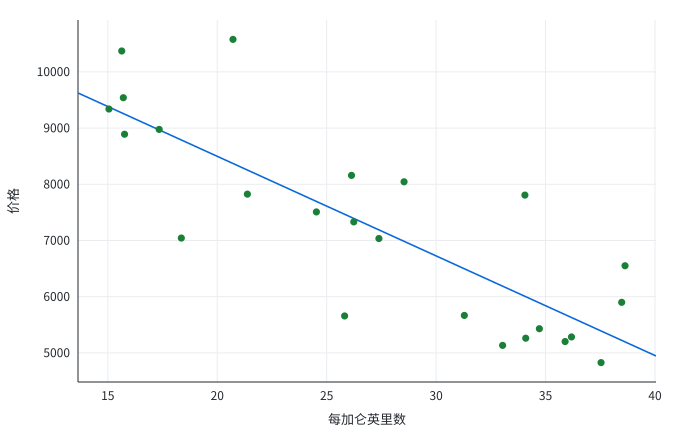

# 价格与油耗

这份报告汇总汽车价格和油耗。

```matlab
rng(1);
mpg = 15 + 25 * rand(24, 1);
weight = 1800 + 2200 * rand(24, 1);
price = 8000 - 180 * mpg + 1.5 * weight + 400 * randn(24, 1);
```

## 描述统计

```matlab
s = matlab_tohtml.summarize('results/summary.html', {'价格', price, '每加仑英里数', mpg, '车重', weight});
```

<figure class="tohtml-table-block"><figcaption class="tohtml-table-title">描述统计</figcaption><div class="tohtml-embedded-table"><table class="pytohtml-table"><thead><tr><th>变量</th><th class="num">N</th><th class="num">均值</th><th class="num">标准差</th><th class="num">最小值</th><th class="num">最大值</th></tr></thead><tbody><tr><td>价格</td><td class="num">24</td><td class="num">7223.584</td><td class="num">1761.275</td><td class="num">4827.867</td><td class="num">10577.589</td></tr><tr><td>每加仑英里数</td><td class="num">24</td><td class="num">27.189</td><td class="num">8.159</td><td class="num">15.053</td><td class="num">38.632</td></tr><tr><td>车重</td><td class="num">24</td><td class="num">2771.326</td><td class="num">628.161</td><td class="num">1847.277</td><td class="num">3983.596</td></tr></tbody></table></div></figure>

共 24 个观测，价格均值约为 7224。

## 价格与油耗

```matlab
matlab_tohtml.scatter('figures/price.svg', price, mpg, 'xlabel', '每加仑英里数', 'ylabel', '价格', 'fit', true);
```

<figure class="tohtml-figure"><figcaption class="tohtml-fig-title">价格与每加仑英里数</figcaption></figure>

## 回归

```matlab
m1 = matlab_tohtml.regress(price, {'每加仑英里数', mpg});
m2 = matlab_tohtml.regress(price, {'每加仑英里数', mpg, '车重', weight});
matlab_tohtml.etable('results/regression.html', {m1, m2}, 'titles', {'(1)', '(2)'}, 'note', '因变量为价格。');
```

<figure class="tohtml-table-block"><figcaption class="tohtml-table-title">价格回归</figcaption><div class="tohtml-embedded-table"><table class="pytohtml-table"><thead><tr><th></th><th class="num">(1)</th><th class="num">(2)</th></tr></thead><tbody><tr><td>每加仑英里数</td><td class="num">-177.165***</td><td class="num">-178.249***</td></tr><tr><td></td><td class="num">(26.295)</td><td class="num">(11.593)</td></tr><tr><td>车重</td><td class="num"></td><td class="num">1.446***</td></tr><tr><td></td><td class="num"></td><td class="num">(0.151)</td></tr><tr><td>常数项</td><td class="num">12040.477***</td><td class="num">8063.118***</td></tr><tr><td></td><td class="num">(745.138)</td><td class="num">(528.678)</td></tr><tr class="stat stat-start"><td>N</td><td class="num">24</td><td class="num">24</td></tr><tr class="stat"><td>R²</td><td class="num">0.674</td><td class="num">0.939</td></tr></tbody></table></div><p class="pytohtml-note">* p&lt;0.1，** p&lt;0.05，*** p&lt;0.01</p>
<p class="pytohtml-note">因变量为价格。</p></figure>

只控制油耗时，每加仑英里数的系数为 -177.2。

$$
price = \beta_0 + \beta_1 mpg + \varepsilon
$$
