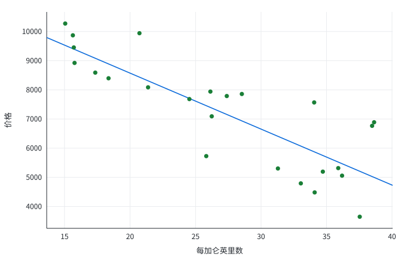

```python
import math
import random
from pathlib import Path

Path("results").mkdir(exist_ok=True)
Path("figures").mkdir(exist_ok=True)
```

# 价格与油耗

```python
rng = random.Random(1)
mpg = [rng.uniform(15, 40) for _ in range(24)]
price = [12000 - 180 * x + rng.gauss(0, 300) for x in mpg]
n = len(price)
mean_price = sum(price) / n
print(f"N = {n}")
```

```text
N = 24
```

```python
print(f"均价 = {mean_price:.0f}")
```

```text
均价 = 7159
```

共 24 个观测，价格均值约为 7159。

## 表 1

```python
table = (
    '<table class="pytohtml-table"><thead><tr>'
    "<th>变量</th><th class=\"num\">N</th><th class=\"num\">均值</th>"
    "</tr></thead><tbody><tr>"
    f"<td>价格</td><td class=\"num\">{n}</td><td class=\"num\">{mean_price:.3f}</td>"
    "</tr></tbody></table>"
)
Path("results/summary.html").write_text(table, encoding="utf-8")
```

<figure class="tohtml-table-block"><figcaption class="tohtml-table-title">价格均值</figcaption><div class="tohtml-embedded-table"><table class="pytohtml-table"><thead><tr><th>变量</th><th class="num">N</th><th class="num">均值</th></tr></thead><tbody><tr><td>价格</td><td class="num">24</td><td class="num">7159.097</td></tr></tbody></table></div></figure>

## 图 1

```python
xmin, xmax = min(mpg), max(mpg)
ymin, ymax = min(price), max(price)
dots = []
for x, y in zip(mpg, price):
    cx = 60 + (x - xmin) / (xmax - xmin) * 520
    cy = 300 - (y - ymin) / (ymax - ymin) * 250
    dots.append(f'<circle cx="{cx:.1f}" cy="{cy:.1f}" r="4" fill="#1a7f37"/>')
svg = (
    '<svg xmlns="http://www.w3.org/2000/svg" width="640" height="360">'
    '<rect width="100%" height="100%" fill="white"/>'
    + "".join(dots)
    + "</svg>"
)
Path("figures/price.svg").write_text(svg, encoding="utf-8")
```

<figure class="tohtml-figure"><figcaption class="tohtml-fig-title">价格与每加仑英里数</figcaption></figure>

## 相关

```python
mx = sum(mpg) / n
cov = sum((x - mx) * (y - mean_price) for x, y in zip(mpg, price))
vx = math.sqrt(sum((x - mx) ** 2 for x in mpg))
vy = math.sqrt(sum((y - mean_price) ** 2 for y in price))
corr = cov / (vx * vy)
print(f"corr = {corr:.2f}")
```

```text
corr = -0.99
```

相关系数为 -0.99，油耗越高价格越低。

$$
price = \beta_0 + \beta_1 mpg + \varepsilon
$$
